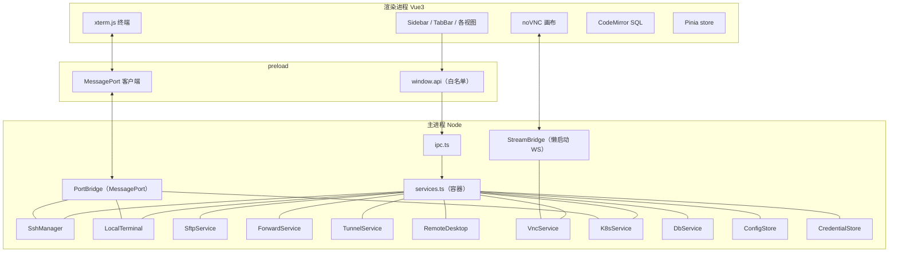

# DesktopTool 设计文档（复刻指南）

> 本文档的目标：**一个不了解本项目的 AI，仅凭本文档即可从零复刻出功能等价的软件**。
> 因此文档按「约束 → 契约 → 机制 → 复刻步骤 → 已知坑」组织，关键部分给出可直接抄写的代码片段与 SQL。
>
> - 文档版本：对应 `package.json` 中 `version 0.1.1`
> - 技术栈：Electron + Vue 3 + TypeScript + electron-vite
> - 平台：Windows（实机验证）、Linux、macOS（构建配置就绪，未实机验证）

---

## 目录

1. [产品定义与验收标准](#1-产品定义与验收标准)
2. [技术选型与关键取舍](#2-技术选型与关键取舍)
3. [工程结构与文件职责](#3-工程结构与文件职责)
4. [共享数据模型（可直接使用）](#4-共享数据模型可直接使用)
5. [IPC 契约（主进程 ↔ 渲染进程）](#5-ipc-契约主进程--渲染进程)
6. [核心机制 A：终端数据通道（MessagePort）](#6-核心机制-a终端数据通道messageport)
7. [核心机制 B：SSH 会话、多跳与端口转发](#7-核心机制-bssh-会话多跳与端口转发)
8. [核心机制 C：远程桌面（RDP 拉起 / VNC 内嵌）](#8-核心机制-c远程桌面rdp-拉起--vnc-内嵌)
9. [核心机制 D：Kubernetes 管理](#9-核心机制-dkubernetes-管理)
10. [核心机制 E：数据库管理](#10-核心机制-e数据库管理)
11. [渲染层设计](#11-渲染层设计)
12. [安全设计](#12-安全设计)
13. [构建、自检与打包](#13-构建自检与打包)
14. [从零复刻步骤（含验收点）](#14-从零复刻步骤含验收点)
15. [已知坑与规避（必读）](#15-已知坑与规避必读)
16. [附录](#16-附录)

---

## 1. 产品定义与验收标准

### 1.1 一句话定位

跨平台桌面「运维工具箱」：SSH 终端 + SFTP + 端口转发 + 远程桌面（RDP/VNC）+ Kubernetes 管理 + 数据库管理，全部收敛在一个多标签应用里。

### 1.2 功能范围（等价复刻的最小集）

| 域 | 必须实现的能力 |
|---|---|
| 连接管理 | 分组树、增删改查、复制、搜索、最近连接、SSH 密码/私钥/口令/keyboard-interactive、多跳跳板机 |
| 终端 | 本地 shell（PTY，不可用时降级管道）、SSH shell、多标签、同连接多开、搜索、复制粘贴、字体/字号/主题、读取 K8s 日志与 Exec |
| SFTP | 目录浏览、上传/下载（进度）、新建目录、重命名、删除、小文件在线编辑 |
| 端口转发 | 本地 `-L`、远程 `-R`、动态 SOCKS5 `-D`，运行态开关与状态展示 |
| 远程桌面 | RDP 三平台拉起（含凭据临时注入、`.rdp` 生成、用完清理）；VNC 内嵌（noVNC）；RDP/VNC over SSH 隧道 |
| Kubernetes | kubeconfig 导入（文件/默认/粘贴/WSL）、context/namespace 切换、资源发现、对象列表 + watch、YAML 查看/编辑（服务端 apply）、删除、扩缩容、滚动重启、Pod 日志、Pod Exec、SSH 隧道接入 |
| 数据库 | MySQL/MariaDB 与 PostgreSQL 连接、结构树（库/表/列/键/索引）、SQL 编辑器（高亮 + schema 补全）、格式化、解析、多查询页、执行与结果网格、单元格编辑生成 UPDATE、事务、切库 |
| 工程 | 多窗口、跨窗口配置同步、三平台打包、5 组无人值守自检 |

### 1.3 硬性设计约束

1. **打包后不得常驻监听 TCP 端口**。终端/PTY 数据必须走 Electron `MessageChannelMain`，而不是本地 WebSocket。
2. 唯一的例外是**功能驱动**的端口：端口转发规则、RDP/VNC/数据库的 SSH 隧道、内置 VNC 的 WS 桥（懒启动、最后一个通道关闭后立即释放）。
3. 凭据不得明文落盘。系统密钥环不可用时默认拒绝保存，需用户显式开启「允许明文」。
4. `contextIsolation: true`、`nodeIntegration: false`，渲染进程只能通过 preload 暴露的白名单 API 访问系统能力。
5. 数据流不走 `ipcRenderer.invoke`（结构化克隆开销大、大输出会卡），只走 MessagePort 或事件推送。

### 1.4 验收方式

```bash
npm run typecheck            # tsc + vue-tsc 均 0 错误
npx electron-vite build      # 构建通过
node_modules/electron/dist/electron.exe . --smoke-test      # 窗口与布局
node_modules/electron/dist/electron.exe . --smoke-ssh       # 需先 npm run mock:ssh
node_modules/electron/dist/electron.exe . --smoke-k8s       # 需本机 ~/.kube/config
node_modules/electron/dist/electron.exe . --smoke-k8s-write # 写操作（会临时建 ConfigMap）
node_modules/electron/dist/electron.exe . --smoke-db        # 不需要真实数据库
```

---

## 2. 技术选型与关键取舍

### 2.1 选型结论

| 层 | 选择 | 理由 |
|---|---|---|
| 桌面框架 | **Electron 33** | SSH/PTY/终端/远程桌面生态最完整；Node 侧能直接起子进程、监听端口、做协议桥接 |
| 渲染层 | Vue 3 + TypeScript + Pinia | 组合式 API 写复杂视图成本低；Pinia 单 store 足够（本应用是单文档型） |
| 构建 | electron-vite 2.3（Vite 5） | main/preload/renderer 三段式，热更新与产物结构清晰 |
| UI | 原生 CSS 变量 + 手写组件（无 UI 框架） | 避免 UI 框架体积与主题冲突；组件总量不大 |
| 终端 | @xterm/xterm 5.5 + fit/webgl/unicode11/search | 事实标准，中文与 256 色支持好 |
| SSH | ssh2 1.16 | 纯 JS，支持 PTY、forwardOut、远程转发、SFTP |
| 本地终端 | node-pty 1.0（**optionalDependency**） | 1.x 自带 N-API 预编译，Electron 下免重编；缺失时降级管道模式 |
| VNC | @novnc/novnc 1.4 | 只需一条 WS URL，协议细节由它处理 |
| K8s | **@kubernetes/client-node 0.22.3** | 见 2.2；1.x 起纯 ESM，与 CJS 主进程冲突 |
| 数据库 | mysql2 3.24 + pg 8.23 | 纯 JS 驱动，无原生编译 |
| SQL 解析 | node-sql-parser 5.4 | 支持 MySQL/PostgreSQL 方言，能给 AST、表/列清单 |
| SQL 格式化 | sql-formatter 15.9 | 方言覆盖好，纯前端可用 |
| SQL 编辑器 | CodeMirror 6 + @codemirror/lang-sql | 比 Monaco 轻一个数量级，自带 schema 补全 |
| YAML | js-yaml 4.3 | kubeconfig / K8s 对象读写 |

### 2.2 关键取舍（复刻时必须遵守）

1. **`@kubernetes/client-node` 锁 0.22.x**
   1.0.0 起包改为 ESM-only，CJS 主进程 `require` 会直接抛错。0.22.3 是最后一个 CJS 版本，且 `main` 指向 `dist/index.js`。
   若要升到 1.x/2.x，必须让主进程整体改 ESM 或让它参与打包（不 externalize），风险高，不推荐。
2. **不用 `electron-store`**：v10 起是 ESM，与 CJS 主进程易冲突。自写 80 行 `ConfigStore`（`fs` + `app.getPath('userData')`），顺带做 schema 归一化。
3. **不用 `keytar`**：已归档且三平台原生编译。用 Electron 内置 `safeStorage`。
4. **不内嵌 RDP**：纯 JS 没有可用 RDP 协议栈。RDP 走「系统客户端拉起 + 参数/凭据代传」，VNC 走真正内嵌。这是本项目最重要的成本控制决策。
5. **终端数据不用 WebSocket**：见第 6 节。用 `MessageChannelMain` 可同时满足「不占端口」与「零序列化开销」。

### 2.3 依赖清单（版本以 `package.json` 为准）

```jsonc
// dependencies（会被打进安装包）
{
  "@kubernetes/client-node": "^0.22.3",
  "js-yaml": "^4.3.2",
  "mysql2": "^3.24.6",
  "node-sql-parser": "^5.4.0",
  "pg": "^8.23.1",
  "ssh2": "^1.16.0",
  "ws": "^8.18.0"            // 仅内置 VNC 的 WS 桥使用
}
// optionalDependencies
{ "node-pty": "^1.0.0" }
// devDependencies（渲染层依赖会被打包进 renderer）
{
  "electron": "^33.3.1", "electron-vite": "^2.3.0", "electron-builder": "^25.1.8",
  "vite": "^5.4.11", "vue": "^3.5.13", "vue-tsc": "^2.1.10", "pinia": "^2.3.0",
  "@xterm/xterm": "^5.5.0", "@xterm/addon-fit": "^0.10.0", "@xterm/addon-webgl": "^0.18.0",
  "@xterm/addon-search": "^0.15.0", "@xterm/addon-unicode11": "^0.8.0",
  "@novnc/novnc": "^1.4.0",
  "@codemirror/{state,view,language,commands,autocomplete,lang-sql}": "^6.x",
  "@lezer/highlight": "^1.2.5", "sql-formatter": "^15.9.0",
  "@types/{node,ssh2,ws,pg,js-yaml}": "*"
}
```

---

## 3. 工程结构与文件职责

```
desktop-tool/
├─ package.json                     # scripts / deps / allowScripts
├─ electron.vite.config.ts          # 三段式构建；renderer 固定 5175；target esnext
├─ electron-builder.yml             # NSIS/AppImage+deb/dmg；asarUnpack **/*.node
├─ tsconfig.json / tsconfig.node.json / tsconfig.web.json
├─ build/                           # 图标等打包资源
├─ scripts/mock-ssh-server.mjs      # 内置 mock SSH（自检用）
├─ docs/build.md                    # 命令手册
├─ docs/DESIGN.md                   # 本文件
└─ src/
   ├─ shared/                       # 主/渲染共用（纯类型 + 少量纯函数）
   │  ├─ types.ts                   # 全部数据模型（第 4 节）
   │  ├─ api.ts                     # preload 暴露的 API 契约（第 5 节）
   │  └─ defaults.ts                # 默认配置、SYSTEM_DATABASES、空配置
   ├─ preload/
   │  ├─ index.ts                   # contextBridge 暴露 window.api；MessagePort 客户端
   │  └─ index.d.ts                 # 渲染层 window.api 类型
   ├─ main/
   │  ├─ index.ts                   # app 生命周期、单实例、菜单、自检入口
   │  ├─ window-manager.ts          # 多窗口工厂（支持携带 sessionId 打开）
   │  ├─ services.ts                # 服务容器（唯一实例）
   │  ├─ ipc.ts                     # 全部 IPC 处理器（薄封装，逻辑在 services）
   │  ├─ smoke.ts                   # 5 组自检实现
   │  ├─ channel-registry.ts        # 通道生命周期登记（终端/PTY/VNC/K8s）
   │  ├─ bridge/
   │  │  ├─ port-bridge.ts          # ★ MessagePort 通道（终端/PTY/K8s 日志与 Exec）
   │  │  └─ stream-bridge.ts        # ★ 懒启动 WS 桥（仅内置 VNC）
   │  ├─ store/
   │  │  ├─ config-store.ts         # config.json 读写 + 归一化 + 原子写
   │  │  └─ credential-store.ts     # safeStorage 加密的 credentials.json
   │  ├─ ssh/
   │  │  ├─ manager.ts              # 连接、多跳、shell、openTcp、SFTP 会话复用
   │  │  ├─ sftp.ts                 # 浏览/上传/下载/读写小文件
   │  │  ├─ forward.ts              # -L / -R / -D(SOCKS5)
   │  │  └─ tunnel.ts               # 一次性本地端口转发（RDP/VNC/K8s/DB 复用）
   │  ├─ pty/local-terminal.ts      # node-pty 优先，缺失降级管道
   │  ├─ vnc/service.ts             # TCP ↔ WS 桥（懒启动）
   │  ├─ remote-desktop/
   │  │  ├─ index.ts                # 探测 + 按平台分发
   │  │  ├─ rdp-file.ts             # .rdp / .remmina 生成
   │  │  ├─ windows.ts              # mstsc + cmdkey 注入/清理
   │  │  ├─ macos.ts                # Windows App / 屏幕共享
   │  │  └─ linux.ts                # xfreerdp → remmina → rdesktop → krdc
   │  ├─ k8s/service.ts             # 集群/发现/CRUD/watch/日志/Exec/隧道
   │  └─ db/service.ts              # 会话/查询/元数据/解析/事务/切库
   └─ renderer/
      ├─ index.html                 # CSP
      └─ src/
         ├─ main.ts / App.vue       # 应用外壳：侧栏 + 标签栏 + 视图 + 弹窗 + Toast
         ├─ styles/global.css       # CSS 变量主题（dark/light）
         ├─ stores/app.ts           # ★ 全局状态与所有业务动作
         ├─ lib/{errors,format,path,terminal-theme,sql,k8s-watch}.ts
         └─ components/
            ├─ Icon.vue InputModal.vue TabBar.vue Sidebar.vue StatusBar.vue
            ├─ TerminalView.vue SqlEditor.vue
            ├─ SessionDialog.vue SettingsDialog.vue CredentialPrompt.vue
            ├─ SftpView.vue ForwardsView.vue ForwardDialog.vue
            ├─ VncView.vue WelcomeView.vue
            ├─ ClusterDialog.vue K8sView.vue
            └─ DbConnectionDialog.vue DbView.vue
```

### 3.1 进程职责边界

- **主进程**：一切系统能力（网络、进程、文件、密钥）。不持有 UI 状态。
- **preload**：只做两件事——把 IPC 包成 `window.api`；持有 MessagePort 并转发数据。**不做业务判断**。
- **渲染进程**：只做 UI 与本地状态（Pinia）。所有持久化/网络都通过 `window.api`。

---

## 4. 共享数据模型（可直接使用）

把下面的内容整体放进 `src/shared/types.ts`，它是主/渲染/预加载三方共用的唯一真相。

```ts
export type Protocol = 'ssh' | 'rdp' | 'vnc'
export type AuthType = 'password' | 'privateKey'
export type ForwardType = 'local' | 'remote' | 'dynamic'
export type ThemeMode = 'dark' | 'light'

export interface RdpOptions {
  width: number; height: number; fullscreen: boolean; clipboard: boolean
  audio: 'local' | 'remote' | 'none'; colorDepth: number; domain: string; adminSession: boolean
}

export interface SessionConfig {
  id: string; name: string; groupId: string | null
  protocol: Protocol; host: string; port: number; username: string
  authType: AuthType; privateKeyPath: string
  /** 经哪条 SSH 会话建隧道（跳板机 / RDP、VNC over SSH） */
  tunnelSessionId: string | null
  rdp: RdpOptions; note: string
  createdAt: number; updatedAt: number; lastUsedAt: number | null
}
export type SessionInput = Omit<SessionConfig, 'id'|'createdAt'|'updatedAt'|'lastUsedAt'> & { id?: string }

export interface GroupConfig { id: string; name: string; parentId: string | null; order: number }

export interface AppSettings {
  theme: ThemeMode; fontSize: number; fontFamily: string
  cursorBlink: boolean; confirmOnClose: boolean
  /** 密钥环不可用时是否允许明文保存凭据 */
  allowPlaintextCredential: boolean
}

export interface ForwardRule {
  id: string; name: string; sessionId: string; type: ForwardType
  bindHost: string; bindPort: number; destHost: string; destPort: number; autoStart: boolean
}
export interface ForwardState {
  ruleId: string; status: 'stopped'|'starting'|'running'|'error'
  message: string; connections: number; startedAt: number | null
}

// ---------- Kubernetes ----------
export interface K8sCluster {
  id: string; name: string
  source: 'file' | 'inline' | 'wsl'
  kubeconfigPath: string; wslDistro: string
  context: string; namespace: string
  tunnelSessionId: string | null
  createdAt: number; lastUsedAt: number | null
}
export type K8sCategory = 'workload'|'network'|'storage'|'config'|'cluster'|'custom'
export interface K8sResourceType {
  apiVersion: string; group: string; version: string; kind: string; plural: string
  namespaced: boolean; verbs: string[]; shortNames: string[]; category: K8sCategory
}
export interface K8sObjectSummary {
  uid: string; name: string; namespace: string; kind: string; apiVersion: string
  createdAt: string; resourceVersion: string
  status: string; ready: string; restarts: number; extra: string
}
export interface K8sObjectRef { apiVersion: string; kind: string; namespace: string; name: string }
export interface K8sListQuery { apiVersion: string; kind: string; namespace: string; limit?: number; labelSelector?: string }
export interface K8sListResult { items: K8sObjectSummary[]; resourceVersion: string; truncated: boolean }
export interface K8sWatchQuery extends K8sListQuery { watchId: string }
export interface K8sWatchEvent {
  watchId: string; type: 'ADDED'|'MODIFIED'|'DELETED'|'ERROR'
  object: K8sObjectSummary | null; message: string
}
export interface K8sPodLogRequest {
  clusterId: string; namespace: string; pod: string; container: string
  tailLines: number; previous: boolean; timestamps: boolean; cols: number; rows: number
}
export interface K8sExecRequest {
  clusterId: string; namespace: string; pod: string; container: string
  command: string; cols: number; rows: number
}
export interface K8sClusterInfo {
  clusterId: string; name: string; version: string
  contexts: string[]; currentContext: string; tunnelActive: boolean
}

// ---------- Database ----------
export type DbKind = 'mysql' | 'postgres'
export interface DbConnection {
  id: string; name: string; kind: DbKind
  host: string; port: number; username: string; database: string; ssl: boolean
  tunnelSessionId: string | null
  createdAt: number; lastUsedAt: number | null
}
export interface DbColumn { name: string; type: string; nullable: boolean; primaryKey: boolean; defaultValue: string }
export interface DbIndex { name: string; columns: string[]; unique: boolean; primary: boolean; definition: string }
export interface DbForeignKey { name: string; columns: string[]; refSchema: string; refTable: string; refColumns: string[] }
export interface DbTable {
  schema: string; name: string; type: 'table'|'view'
  columns: DbColumn[]; indexes: DbIndex[]; foreignKeys: DbForeignKey[]
}
export interface DbMetadata {
  database: string                      // 当前库；为空字符串表示「全部库」
  groupLabel: 'database' | 'schema'     // MySQL 用 database，PG 用 schema
  tables: DbTable[]; fetchedAt: number
}
export interface DbQueryRequest { connectionId: string; sql: string; maxRows?: number }
export interface DbResultSet {
  command: string; columns: { name: string; type: string }[]; rows: unknown[][]
  rowCount: number; affectedRows: number; durationMs: number; truncated: boolean; notice: string
}
export interface DbQueryResponse { results: DbResultSet[]; error: string; errorStatement: number }
export interface DbStatementInfo { type: string; text: string; tables: string[]; columns: string[] }
export interface DbParseResult { statements: DbStatementInfo[]; tables: string[]; error: string }
export interface DbConnectResult {
  serverVersion: string; database: string; metadata: DbMetadata; inTransaction: boolean
}

// ---------- 其它 ----------
export interface AppConfig {
  schemaVersion: number
  groups: GroupConfig[]; sessions: SessionConfig[]
  forwards: ForwardRule[]; settings: AppSettings
  k8sClusters: K8sCluster[]; dbConnections: DbConnection[]
}
export interface SftpEntry {
  name: string; path: string; type: 'file'|'dir'|'link'|'other'
  size: number; mtime: number; mode: number; owner: string; group: string
}
export interface SftpProgress {
  id: string; name: string; direction: 'upload'|'download'
  transferred: number; total: number; done: boolean; error: string
}
export interface RdClientInfo { kind: 'rdp'|'vnc'; id: string; label: string; available: boolean; detail: string }
export interface LaunchResult { ok: boolean; client: string; message: string; command: string }
export interface CredentialStatus { available: boolean; backend: string; degraded: boolean }

export interface BridgeEndpoint {
  channelId: string
  /** 仅内置 VNC 使用：noVNC 只支持 WebSocket 传输 */
  url?: string
}
export interface SshStatusEvent { sessionId: string; status: 'connecting'|'ready'|'closed'|'error'; message: string }
export interface ChannelClosedEvent { channelId: string; reason: string }
export interface AppInfo {
  version: string; platform: string; arch: string; electron: string
  ptyAvailable: boolean; userDataPath: string
}
```

`src/shared/defaults.ts` 需提供：

```ts
export const SCHEMA_VERSION = 1
export const SYSTEM_DATABASES = [
  'information_schema','mysql','performance_schema','sys',
  'pg_catalog','pg_toast','pg_temp_1','pg_toast_temp_1'
]
export function defaultRdpOptions(): RdpOptions
export function defaultSettings(): AppSettings
export function emptySessionInput(): SessionInput
export function emptyConfig(): AppConfig   // 所有数组为空、settings 用默认
```

---

## 5. IPC 契约（主进程 ↔ 渲染进程）

### 5.1 通道命名与约定

- 请求/响应：`ipcMain.handle('<domain>:<action>', ...)` ↔ `ipcRenderer.invoke`
- 推送：`webContents.send('<domain>:<event>', payload)`
- 所有异常在主进程抛出 `Error(中文可读信息)`；渲染层用 `errorMessage()` 统一清洗（去掉 `Error invoking remote method 'x': Error: ` 前缀）。

### 5.2 事件通道（主 → 渲染）

| 通道 | 载荷 | 触发时机 |
|---|---|---|
| `ssh:status` | `SshStatusEvent` | 连接中/就绪/关闭/错误 |
| `sftp:progress` | `SftpProgress` | 上传下载进度（节流后） |
| `forward:state` | `ForwardState` | 转发规则状态变化 |
| `channel:closed` | `ChannelClosedEvent` | 通道被主进程关闭 |
| `config:changed` | `null` | 任意配置写入后广播（多窗口同步） |
| `k8s:watch` | `K8sWatchEvent` | K8s watch 增量事件 |
| `stream:port` | `{ channelId }` + MessagePort | 转移数据通道端口对象 |

### 5.3 请求通道（完整表）

| 通道 | 参数 | 返回 |
|---|---|---|
| `app:info` | — | `AppInfo` |
| `app:openUserData` / `app:pickFile` | `title?` | `void` / `string` |
| `window:new` | `sessionId?` | `void` |
| `config:get` | — | `AppConfig` |
| `config:saveSession` / `deleteSession` / `touchSession` | 见类型 | `SessionConfig` / `void` |
| `config:saveGroup` / `deleteGroup` | 见类型 | `GroupConfig` / `void` |
| `config:saveSettings` | `Partial<AppSettings>` | `AppSettings` |
| `config:saveForward` / `deleteForward` | 见类型 | `ForwardRule` / `void` |
| `config:exportConfig` / `importConfig` | `includeSecrets` / — | `{ok,path}` / `{ok,message}` |
| `credential:status` / `set` / `remove` / `has` | `ref, secret, allowPlaintext?` | `CredentialStatus` / `void` / `void` / `boolean` |
| `ssh:connect` | `{sessionId,password?,passphrase?,remember?}` | `void` |
| `ssh:disconnect` / `ssh:isConnected` | `sessionId` | `void` / `boolean` |
| `ssh:openShell` | `{sessionId,cols,rows}` | `BridgeEndpoint` |
| `pty:create` | `{cols,rows,shell?}` | `BridgeEndpoint & {driver}` |
| `stream:attach` | `channelId` | `boolean`（是否成功把 port2 交给该窗口） |
| `channel:close` | `channelId` | `void` |
| `sftp:list` / `home` / `mkdir` / `rename` / `remove` / `readText` / `writeText` / `upload` / `download` | 见 `api.ts` | 见 `api.ts` |
| `forward:list` / `start` / `stop` | `ruleId` | `ForwardState` |
| `rd:detect` / `rd:launch` | `sessionId` | `RdClientInfo[]` / `LaunchResult` |
| `vnc:open` | `sessionId` | `BridgeEndpoint`（含 `url`） |
| `k8s:*` | 见 5.4 | 见 5.4 |
| `db:*` | 见 5.5 | 见 5.5 |
| `clipboard:read` / `write` | `text` | `string` / `void` |

### 5.4 K8s 通道一览

```
k8s:listClusters            → K8sCluster[]
k8s:importFromFile          → K8sCluster       （主进程弹文件选择框）
k8s:importFromDefault       → K8sCluster       （~/.kube/config）
k8s:importFromText          (text, name)
k8s:importFromWsl           (distro, configPath)
k8s:listWslDistros          → string[]
k8s:defaultKubeconfigPath   → string
k8s:removeCluster           (id)
k8s:setContext              (clusterId, context) → K8sCluster
k8s:setNamespace            (clusterId, namespace)
k8s:setTunnel               (clusterId, sessionId|null) → K8sCluster
k8s:connect                 (clusterId) → K8sClusterInfo
k8s:listNamespaces          (clusterId) → string[]
k8s:resourceTypes           (clusterId) → K8sResourceType[]
k8s:listObjects             (clusterId, K8sListQuery) → K8sListResult
k8s:getObjectYaml           (clusterId, K8sObjectRef) → string
k8s:applyObject             (clusterId, yaml) → string(成功消息)
k8s:deleteObject            (clusterId, K8sObjectRef)
k8s:scaleObject             (clusterId, K8sObjectRef & {replicas})
k8s:restartObject           (clusterId, K8sObjectRef)
k8s:podContainers           (clusterId, namespace, pod) → string[]
k8s:startWatch / stopWatch  (clusterId, K8sWatchQuery) / (watchId)
k8s:openLog                 (K8sPodLogRequest) → BridgeEndpoint
k8s:openExec                (K8sExecRequest) → BridgeEndpoint
```

### 5.5 DB 通道一览

```
db:listConnections   → DbConnection[]
db:saveConnection    (Partial<DbConnection> & {password?}) → DbConnection
db:deleteConnection  (id)
db:testConnection    (DbConnection, password) → DbConnectResult   // 不落库
db:connect           (id) → DbConnectResult
db:disconnect / db:cancel  (id)
db:metadata          (id) → DbMetadata
db:listDatabases     (id) → string[]
db:switchDatabase    (id, database) → DbMetadata
db:transaction       (id, 'begin'|'commit'|'rollback') → boolean(inTransaction)
db:query             (DbQueryRequest) → DbQueryResponse
db:parse             (kind, sql) → DbParseResult                  // 纯本地，不连库
```

### 5.6 `Api` 类型与 preload 实现要点

`src/shared/api.ts` 里的 `Api` 接口就是 `window.api` 的类型。preload 用一个 `invoke<T>()` 包装：

```ts
const invoke = <T>(channel: string, ...args: unknown[]) => ipcRenderer.invoke(channel, ...args) as Promise<T>
const subscribe = <T>(channel: string, cb: (payload: T) => void) => {
  const listener = (_e: unknown, payload: T) => cb(payload)
  ipcRenderer.on(channel, listener as never)
  return () => ipcRenderer.removeListener(channel, listener as never)
}
contextBridge.exposeInMainWorld('api', api)
```

**关键约束**：渲染层任何时候都**不能把 Vue 的响应式 Proxy 直接传给 IPC**，否则会抛
`An object could not be cloned.`。所有表单提交必须显式拷贝成普通对象：

```ts
// ✅ 正确
const payload = { id: form.value.id, name: form.value.name, port: Number(form.value.port), /* ... */ }
// ✅ 也可以（深度去响应式）
const payload = JSON.parse(JSON.stringify({ ...form }))
// ❌ 错误：form.value 本身是 Proxy
await window.api.db.testConnection(form.value, password)
```

---

## 6. 核心机制 A：终端数据通道（MessagePort）

### 6.1 为什么不用 WebSocket

早期实现用本地 WS 服务转发字节流。问题：应用常驻一个监听端口（虽然只绑 `127.0.0.1`），且需要 token 校验、CSP 放行 `ws://`。
`ipcRenderer.invoke` 传字节流会被结构化克隆拖慢（大量输出明显卡顿），不可用。

`MessageChannelMain` + `webContents.postMessage(channel, msg, [port2])` 可以把端口对象**转移**给渲染进程，之后双向收发是原生通道，既不占 TCP 端口，也没有 IPC 序列化开销。

### 6.2 通道协议（必须逐字节对齐）

```
主进程 ──► 渲染进程：Uint8Array（原始字节）
                     string JSON { t: 'close', reason }
渲染进程 ──► 主进程：Uint8Array（键盘输入 / 上行数据）
                     string JSON { t: 'resize', cols, rows }
```

### 6.3 主进程实现（`src/main/bridge/port-bridge.ts`）

要点：

1. `create(channelId, hooks)` 只登记回调，不创建端口。
2. `attach(channelId, webContents)` 才创建 `MessageChannelMain`，`port1` 留主进程、`port2` 转移出去。
3. attach 之前产生的输出进 **backlog**（上限 512KB，超限丢最旧），attach 后顺序刷出——否则 SSH banner/首屏会丢。
4. `release(channelId, reason)` 先发 `{t:'close'}` 再 `port.close()`。
5. 主进程 `port.postMessage()` **不支持转移 ArrayBuffer**，只能转移 MessagePort；所以每次发送要拷贝成独立 `Uint8Array`，不能用 `data.buffer`（ssh2 的 Buffer 来自池化 ArrayBuffer，共享会出脏数据）。

```ts
export class PortBridge {
  private ports = new Map<string, MessagePortMain>()
  private hooks = new Map<string, ChannelHooks>()
  private backlog = new Map<string, Buffer[]>()
  private backlogSize = new Map<string, number>()

  create(channelId: string, hooks: ChannelHooks) { this.hooks.set(channelId, hooks) }

  attach(channelId: string, target: WebContents): boolean {
    const hooks = this.hooks.get(channelId)
    if (!hooks || target.isDestroyed()) return false
    if (this.ports.has(channelId)) return true

    const { port1, port2 } = new MessageChannelMain()
    this.ports.set(channelId, port1)

    port1.on('message', (event) => {
      const data: unknown = event.data
      if (typeof data === 'string') {                       // 控制帧
        const msg = JSON.parse(data)
        if (msg.t === 'resize') hooks.onResize?.(msg.cols, msg.rows)
        return
      }
      if (ArrayBuffer.isView(data)) hooks.onData(Buffer.from(data.buffer, data.byteOffset, data.byteLength))
      else if (data instanceof ArrayBuffer) hooks.onData(Buffer.from(data))
    })
    port1.start()

    target.postMessage('stream:port', { channelId }, [port2])
    this.flush(channelId)
    return true
  }

  push(channelId: string, data: Buffer) {
    const port = this.ports.get(channelId)
    if (port) { port.postMessage(new Uint8Array(data)); return }   // 必须拷贝
    // 否则进 backlog（略）
  }

  release(channelId: string, reason = 'closed') {
    const port = this.ports.get(channelId)
    if (port) {
      try { port.postMessage(JSON.stringify({ t: 'close', reason })) } catch {}
      try { port.close() } catch {}
    }
    /* 清理 maps */
  }
}
```

### 6.4 渲染侧实现（`src/preload/index.ts`）

```ts
const activeStreams = new Map<string, ActiveStream>()
const pendingStreams = new Map<string, { resolve: (port: MessagePort) => void }>()

ipcRenderer.on('stream:port', (event, payload: { channelId?: string }) => {
  const channelId = payload?.channelId ?? ''
  const pending = channelId ? pendingStreams.get(channelId) : undefined
  if (channelId) pendingStreams.delete(channelId)
  const port = event.ports?.[0]
  if (!port || !pending) { port?.close(); return }
  pending.resolve(port)
})

async function openStream(channelId: string, handlers: StreamHandlers) {
  const portPromise = new Promise<MessagePort>((resolve, reject) => {
    pendingStreams.set(channelId, { resolve })
    setTimeout(() => {                              // 5s 超时兜底
      if (pendingStreams.delete(channelId)) reject(new Error('数据通道建立超时'))
    }, 5000)
  })

  const attached = await invoke<boolean>('stream:attach', channelId)
  if (!attached) { pendingStreams.delete(channelId); throw new Error('数据通道不存在或已关闭') }

  const port = await portPromise
  port.onmessage = (event) => {
    const data = event.data
    if (data instanceof Uint8Array) handlers.onData(data)
    else if (data instanceof ArrayBuffer) handlers.onData(new Uint8Array(data))
    else if (typeof data === 'string') {
      const msg = JSON.parse(data)
      if (msg.t === 'close') handlers.onClose(msg.reason ?? 'closed')
    }
  }
  port.start()
  activeStreams.set(channelId, { port, ...handlers })
}
```

**时序要求**：渲染进程必须先调用 `stream.open()`（内部先登记 pending 再 invoke attach），主进程 attach 时才转移端口。若顺序颠倒，端口到达时没有等待者，会被直接关闭。

### 6.5 通道使用方

| 使用方 | 建立方式 | 关闭语义 |
|---|---|---|
| SSH shell | `ssh.openShell()` → `{channelId}` | 主进程 `stream.close(id)` → 关闭 SSH channel |
| 本地 PTY | `pty.create()` → `{channelId, driver}` | kill pty |
| K8s Pod 日志（只读） | `k8s.openLog()` → `{channelId}` | abort 日志流 |
| K8s Pod Exec | `k8s.openExec()` → `{channelId}` | 关闭 WebSocket |

终端组件 `TerminalView.vue` 通过 `props.channelId` 判断：有值就直接用现成通道（K8s 场景），无值才自己调 `pty.create` / `ssh.openShell`。

### 6.6 VNC 是唯一例外

noVNC 只接受 WebSocket URL，因此 `StreamBridge`（WS 版）保留给 VNC，但改为**懒启动**：

```ts
async ensureStarted() { if (this.wss) return; /* WebSocketServer({host:'127.0.0.1', port:0}) */ }
private maybeStop() { if (sockets.size === 0 && hooks.size === 0) { wss.close(); port = 0 } }
```

`VncService.open()` → `await bridge.ensureStarted()` → `{ channelId, url }`；最后一个 VNC 通道释放时自动关闭监听。**空闲时不监听任何端口**。

---

## 7. 核心机制 B：SSH 会话、多跳与端口转发

### 7.1 连接与凭据

- `SshManager` 按 `sessionId` 缓存 `Client`，同一 session 的多开终端**复用同一条 TCP 连接**，每个终端是独立 channel。
- 认证优先级：`password` → `privateKey`(+`passphrase`) → 默认 agent；`tryKeyboard` 时上报 `AUTH_REQUIRED::<sessionId>::<提示>` 让渲染层弹密码框。
- 凭据存 `credentialRef.password(sessionId)` / `passphrase(sessionId)`（`session:<id>:password`），明文只存在于内存与 `safeStorage` 密文文件。
- keepalive：`keepaliveInterval: 15000`。
- 状态事件：`connecting` / `ready` / `closed` / `error`，渲染层据此显示徽标。

### 7.2 多跳（ProxyJump 语义）

用 `client.forwardOut()` 建立到下一跳的 TCP 流，再以该流作为 `connect({ sock })` 的入参，最多 5 跳：

```ts
let sock: stream.Duplex | undefined
for (const hop of hops) {
  const next = new Client()
  await new Promise<void>((ok, fail) => {
    next.once('ready', ok).once('error', fail)
      .connect({ ...hopOptions(hop), sock })
  })
  sock = await new Promise((ok, fail) =>
    next.forwardOut('127.0.0.1', 0, target.host, target.port, (err, s) => err ? fail(err) : ok(s)))
}
```

### 7.3 Shell

```ts
client.shell({ term: 'xterm-256color', cols, rows }, (err, stream) => {
  bridge.create(channelId, {
    onData: (d) => stream.write(d),
    onResize: (c, r) => stream.setWindow(r, c, 0, 0),
    onClose: () => stream.close()
  })
  stream.on('data', (d) => bridge.push(channelId, d))
  stream.stderr.on('data', (d) => bridge.push(channelId, d))
  stream.on('close', () => bridge.release(channelId, 'closed'))
})
```

### 7.4 三种端口转发

| 类型 | 实现要点 |
|---|---|
| `local` (-L) | `net.createServer()` 监听 `bindHost:bindPort`；每个连接 `client.forwardOut(srcIP, srcPort, destHost, destPort, cb)`，双向 `pipe` |
| `remote` (-R) | `client.on('tcp connection', (details, accept) => ...)` 接受远端连接，再 `net.connect(destHost, destPort)` 对接 |
| `dynamic` (-D) | 自己实现 SOCKS5 握手：`05 01 00` → 应答 `05 00` → 读 `05 01 00 ATYP ADDR PORT` → `forwardOut` → 回 `05 00 00 01 00000000 0000` → 进入裸转发 |

`connections` 计数用于 UI 展示；`stop()` 关闭 server、销毁全部 socket、移除 `tcp connection` 监听。

### 7.5 一次性隧道（RDP/VNC/K8s/DB 共用）

```ts
// src/main/ssh/tunnel.ts
async open(sessionId: string, host: string, port: number): Promise<LocalTunnel> {
  const server = net.createServer((socket) => {
    client.forwardOut(socket.remoteAddress ?? '127.0.0.1', socket.remotePort ?? 0, host, port,
      (err, channel) => err ? socket.destroy() : (socket.pipe(channel).pipe(socket)))
  })
  await listen(server, '127.0.0.1', 0)
  return { host: '127.0.0.1', port: (server.address() as AddressInfo).port, close: () => server.close() }
}
```

- RDP/VNC：把目标端口映射到本地随机端口，再用系统客户端 / noVNC 连本地。
- K8s：见 9.2（改写 server + 保持 TLS SNI）。
- DB：见 10.1。

---

## 8. 核心机制 C：远程桌面（RDP 拉起 / VNC 内嵌）

### 8.1 平台分发

`RemoteDesktopService.detect()` 返回当前平台可用客户端列表（供 UI 展示与选择），`launch(sessionId)` 按优先级拉起：

| 平台 | 探测顺序 | 拉起方式 |
|---|---|---|
| Windows | `mstsc.exe` | 生成 `.rdp` + `cmdkey` 注入凭据 → `spawn(mstsc, [file])` |
| macOS | `Windows App` → `Microsoft Remote Desktop` → 系统屏幕共享 | `open -a "Windows App" x.rdp` / `open vnc://user@host` |
| Linux | `xfreerdp` → `remmina` → `rdesktop` → `krdc` | `xfreerdp /v:host:port /u:user /dynamic-resolution +clipboard` |

全部不可用时返回 `{ok:false, message, command}`，UI 展示可复制的连接命令与安装提示（**不打包任何第三方客户端二进制**）。

### 8.2 Windows RDP 关键细节

1. `.rdp` 必须是 **UTF-16LE 且带 BOM**，否则中文用户名/路径会乱码。
2. `mstsc` 不接受命令行密码，必须 `cmdkey /generic:TERMSRV/<host> /user:<u> /pass:<p>` 预注入。
3. `mstsc` 会把会话交给已有进程后**立即退出**，所以清理要延迟（30s）并做应用退出兜底。

```ts
const body = [
  `full address:s:${host}:${port}`,
  `username:s:${username}`,
  'screen mode id:i:2', 'desktopwidth:i:1920', 'desktopheight:i:1080',
  'session bpp:i:32', 'redirectclipboard:i:1', 'audiomode:i:0',
  'authentication level:i:2', 'prompt for credentials:i:0'
].join('\r\n')

await fs.writeFile(rdpFile, '\ufeff' + body, 'utf16le')
if (password) await execFile('cmdkey.exe', [`/generic:TERMSRV/${host}`, `/user:${username}`, `/pass:${password}`])
spawn('mstsc.exe', [rdpFile], { detached: true, stdio: 'ignore' }).unref()
setTimeout(() => {
  execFile('cmdkey.exe', [`/delete:TERMSRV/${host}`], () => {})
  fs.unlink(rdpFile).catch(() => {})
}, 30_000)
```

### 8.3 VNC 内嵌

主进程把目标 TCP 灌进 `StreamBridge`：

```ts
const socket = net.connect({ host, port })
bridge.create(channelId, { onData: (d) => socket.write(d), onClose: () => socket.destroy() })
socket.on('data', (d) => bridge.push(channelId, d))
socket.on('close', () => bridge.release(channelId))
return { channelId, url: bridge.endpoint(channelId) }   // ws://127.0.0.1:<port>/stream?id=..&token=..
```

渲染层：

```ts
import RFB from '@novnc/novnc'
const rfb = new RFB(canvasEl, endpoint.url!, { shared: true, wsProtocols: ['binary'] })
rfb.scaleViewport = true
if (password) rfb.credentials = { password }
```

---

## 9. 核心机制 D：Kubernetes 管理

### 9.1 客户端与 kubeconfig

- 用 `@kubernetes/client-node@0.22.x`：`KubeConfig` / `KubernetesObjectApi` / `Watch` / `Log` / `Exec` / `VersionApi`。
- kubeconfig 全文用 `safeStorage` 加密存 `k8s:<clusterId>:kubeconfig`；`config.json` 只存元数据（来源、路径、context、namespace、tunnelSessionId）。
- 三种来源：
  1. `file`：`kc.loadFromFile(path)`；
  2. `inline`：`kc.loadFromString(text)` + `kc.makePathsAbsolute(dir)`（相对证书路径）；
  3. `wsl`：`wsl.exe -d <distro> cat <path>` 读文本，**并把文件型证书/tokenFile 内联成 base64**（WSL 路径 Windows 读不到）：
     ```
     certificate-authority → certificate-authority-data
     client-certificate    → client-certificate-data
     client-key            → client-key-data
     tokenFile             → token
     ```
- 每个 `clusterId` 缓存一份运行时 `{ kc, version, tunnel?, resourceTypes? }`；切 context / 改隧道 / 删集群时销毁并重建。

### 9.2 SSH 隧道接入（关键）

集群 API 只在内网可达时，用 SSH 会话做隧道。**必须保持 TLS 校验**：

```ts
const url = new URL(current.server)
const tunnel = await tunnels.open(cluster.tunnelSessionId, url.hostname, Number(url.port || 443))
const index = kc.clusters.findIndex((c) => c.name === current.name)
kc.clusters[index] = {
  ...current,
  server: `https://127.0.0.1:${tunnel.port}`,
  tlsServerName: url.hostname          // 关键：SNI 与证书校验仍用原域名
}
```

`Cluster` 字段是 `readonly`，只能整体替换对象，不能改属性。

### 9.3 通用请求（用于 discovery 与通用 CRUD）

不使用各资源专用客户端类（那样 677 个类无法穷举），而是裸 HTTPS + kubeconfig 注入：

```ts
const options: https.RequestOptions = {
  method, protocol: base.protocol, hostname: base.hostname,
  port: base.port || '443',
  path: `${base.pathname.replace(/\/$/, '')}${pathname}`,
  headers: { accept: 'application/json', ...(contentType ? { 'content-type': contentType } : {}) },
  timeout: 30000
}
await kc.applyToHTTPSOptions(options)     // 注入 ca/cert/key、Authorization、servername、rejectUnauthorized
```

错误翻译（403/401/404 给出中文提示）集中在 `describeStatus()`。

### 9.4 资源发现

```
GET /api/v1          → core 资源列表
GET /apis            → APIGroupList（含 preferredVersion）
GET /apis/<g>/<v>    → 该组资源列表
```

过滤：跳过含 `/` 的子资源（如 `pods/status`）、跳过没有 `list` 动词的资源。
归类：`CATEGORY_BY_KIND` 表（Pod/Deployment→workload，Service/Ingress→network，PVC/PV→storage，ConfigMap/Secret→config，Node/Namespace→cluster），非 `*.k8s.io` 的组 → `custom`。

### 9.5 列表 / YAML / 写操作

路径构造：

```
core:  /api/v1[/namespaces/<ns>]/<plural>
其余:  /apis/<group>/<version>[/namespaces/<ns>]/<plural>
```

| 操作 | 请求 |
|---|---|
| 列表 | `GET <collection>?limit=500[&labelSelector=]` → `summarize()` 压成扁平摘要（status/ready/restarts/extra） |
| YAML | `GET <collection>/<name>`，删除 `metadata.managedFields` 后 `yaml.dump` |
| 更新 | `PATCH <collection>/<name>?fieldManager=desktop-tool&force=true`，`content-type: application/apply-patch+yaml`（服务端 apply） |
| 删除 | `DELETE <collection>/<name>`，body `{apiVersion:'v1',kind:'DeleteOptions',propagationPolicy:'Background'}` |
| 扩缩容 | `PATCH <collection>/<name>/scale`，merge-patch `{spec:{replicas}}` |
| 滚动重启 | `PATCH <collection>/<name>`，merge-patch `{spec:{template:{metadata:{annotations:{'kubectl.io/restartedAt': now}}}}}` |

### 9.6 Watch

```ts
const watcher = new Watch(kc)
watcher.watch(path, { allowWatchBookmarks: true, timeoutSeconds: 240, resourceVersion },
  (phase, obj) => { /* BOOKMARK 忽略；ADDED/MODIFIED/DELETED → 推送 K8sWatchEvent */ },
  (err) => { /* 指数退避重连，最多 6 次；超过则推 ERROR 事件让前端重列表 */ })
```

前端收到 `ERROR` 时重新 `listObjects` 并重新 `startWatch`。

### 9.7 Pod 日志与 Exec

**日志**：`new Log(kc).log(ns, pod, container, sink, { follow: true, tailLines, timestamps, previous })`，sink 是自定义 `Writable`，`_write` 里 `bridge.push(channelId, chunk)`；返回的 request 用于 abort。前端用只读终端（`disableStdin: true`）。

**Exec**：`new Exec(kc).exec(ns, pod, container, ['/bin/sh','-c', cmd], stdout, stderr, stdin, true, statusCb)`。
为了让 `@kubernetes/client-node` 自动发送 `TerminalSizeQueue`（否则全屏程序排版错乱），`stdout` 必须实现 `ResizableStream` 形状：

```ts
class ResizableSink extends Writable {
  columns: number
  rows: number
  override _write(chunk: Buffer, _enc, cb) { this.sink(Buffer.from(chunk)); cb() }
  resize(cols: number, rows: number) { this.columns = cols; this.rows = rows; this.emit('resize') }
}
```

`kb` 通过 `PortBridge.hooks.onResize` → `sink.resize()` → 客户端库自动发 `ResizeStream`。

---

## 10. 核心机制 E：数据库管理

### 10.1 连接与隧道

- `mysql2`: `createConnection({ host, port, user, password, database, ssl, connectTimeout: 10000, dateStrings: true, supportBigNumbers: true, bigNumberStrings: true, multipleStatements: false })`
- `pg`: `new PgClient({ host, port, user, password, database, ssl, connectionTimeoutMillis: 10000, statement_timeout: 120000, query_timeout: 120000 })`
- 指定 `tunnelSessionId` 时先 `tunnels.open(sessionId, host, port)`，改连 `127.0.0.1:<本地端口>`。
- 「数据库」留空是合法的：MySQL 会连到无默认库，元数据列出全部库（见 10.4）。

### 10.2 查询执行

- 先 `splitStatements(sql)` 拆分，再**逐条执行**（比 `multipleStatements: true` 更安全，也能精确定位错误在第几条）。
- MySQL：`connection.query({ sql, rowsAsArray: true, timeout: 120000 })` → `[rows, fields]`；SELECT 有 `fields`，DML 返回 `ResultSetHeader.affectedRows`。
- PG：`client.query({ text, rowMode: 'array' })` → `{ fields, rows, command, rowCount }`。
- 单元格归一化：`Date → ISO`、`Buffer → 0x…（截断）`、`bigint → string`、对象 → JSON 字符串、`null` 保留。
- 行数上限默认 1000，超出截断并给出 `notice`。
- 取消：直接 `destroy()` 连接并从缓存移除，下次执行自动重连。

### 10.3 语句拆分算法（必须逐字符状态机）

不能用 `split(';')`。需要处理：单引号（含 `''` 与 `\'`）、双引号、反引号、`--` 行注释、`#` 行注释、`/* */` 块注释、PostgreSQL `$$ ... $$`（含 `$tag$`）。

```ts
export function splitStatements(sql: string): string[] {
  const result: string[] = []
  let current = ''
  let i = 0
  let inSingle = false, inDouble = false, inBacktick = false
  let inLineComment = false, inBlockComment = false, dollarTag = ''

  while (i < sql.length) {
    const ch = sql[i], next = sql[i + 1]
    if (inLineComment)  { current += ch; if (ch === '\n') inLineComment = false; i++; continue }
    if (inBlockComment) { current += ch; if (ch === '*' && next === '/') { current += '/'; i += 2; inBlockComment = false; continue } i++; continue }
    if (dollarTag)      { if (sql.startsWith(dollarTag, i)) { current += dollarTag; i += dollarTag.length; dollarTag = ''; continue } current += ch; i++; continue }
    if (inSingle)       { current += ch; if (ch === '\\' && next !== undefined) { current += next; i += 2; continue }
                          if (ch === "'" && next === "'") { current += "'"; i += 2; continue }
                          if (ch === "'") inSingle = false; i++; continue }
    // inDouble / inBacktick 同理（双写转义）
    if (ch === '-' && next === '-') { inLineComment = true;  current += '--'; i += 2; continue }
    if (ch === '#')                 { inLineComment = true;  current += ch;   i++;    continue }
    if (ch === '/' && next === '*') { inBlockComment = true; current += '/*'; i += 2; continue }
    if (ch === "'") { inSingle = true;  current += ch; i++; continue }
    if (ch === '"') { inDouble = true;  current += ch; i++; continue }
    if (ch === '`') { inBacktick = true; current += ch; i++; continue }
    if (ch === '$') {
      const m = /^\$[A-Za-z_][A-Za-z0-9_]*\$|^\$\$/.exec(sql.slice(i))
      if (m) { dollarTag = m[0]; current += dollarTag; i += dollarTag.length; continue }
    }
    if (ch === ';') { const t = current.trim(); if (t) result.push(t); current = ''; i++; continue }
    current += ch; i++
  }
  const tail = current.trim()
  if (tail) result.push(tail)
  return result
}
```

渲染层还需一个**带偏移**的版本（`src/renderer/src/lib/sql.ts`），用于「执行光标所在语句」：返回 `{ text, from, to }[]`，并过滤掉只含注释的片段。

### 10.4 元数据 SQL 清单

**MySQL 库列表**（注意必须 `rowsAsArray`，否则按对象取下标会得到 `undefined`）：

```ts
const [rows] = await conn.query({ sql: 'SHOW DATABASES', rowsAsArray: true })
```

**MySQL 表 / 列 / 索引 / 外键**（`scoped = 指定了库` 时加 `WHERE TABLE_SCHEMA = ?`，否则查全部，业务库排前、系统库排后）：

```sql
-- tables
SELECT TABLE_SCHEMA AS schemaName, TABLE_NAME AS tableName, TABLE_TYPE AS tableType
FROM information_schema.TABLES [WHERE TABLE_SCHEMA = ?] ORDER BY TABLE_SCHEMA, TABLE_NAME

-- columns
SELECT TABLE_SCHEMA AS schemaName, TABLE_NAME AS tableName, COLUMN_NAME AS columnName,
       COLUMN_TYPE AS columnType, IS_NULLABLE AS nullable, COLUMN_KEY AS columnKey,
       COLUMN_DEFAULT AS columnDefault
FROM information_schema.COLUMNS [WHERE TABLE_SCHEMA = ?] ORDER BY TABLE_SCHEMA, TABLE_NAME, ORDINAL_POSITION

-- indexes
SELECT TABLE_SCHEMA AS schemaName, TABLE_NAME AS tableName, INDEX_NAME AS indexName,
       NON_UNIQUE AS nonUnique, COLUMN_NAME AS columnName
FROM information_schema.STATISTICS [WHERE TABLE_SCHEMA = ?] ORDER BY TABLE_SCHEMA, TABLE_NAME, INDEX_NAME, SEQ_IN_INDEX

-- foreign keys
SELECT TABLE_SCHEMA AS schemaName, TABLE_NAME AS tableName, CONSTRAINT_NAME AS constraintName,
       COLUMN_NAME AS columnName, REFERENCED_TABLE_SCHEMA AS refSchema,
       REFERENCED_TABLE_NAME AS refTable, REFERENCED_COLUMN_NAME AS refColumn
FROM information_schema.KEY_COLUMN_USAGE
WHERE REFERENCED_TABLE_NAME IS NOT NULL [AND TABLE_SCHEMA = ?]
```

**PostgreSQL**：

```sql
SELECT table_schema AS "schemaName", table_name AS "tableName", table_type AS "tableType"
FROM information_schema.tables WHERE table_schema NOT IN ('pg_catalog','information_schema')

SELECT table_schema AS "schemaName", table_name AS "tableName", column_name AS "columnName",
       data_type AS "columnType", is_nullable AS "nullable", column_default AS "columnDefault"
FROM information_schema.columns WHERE table_schema NOT IN ('pg_catalog','information_schema')

-- 主键
SELECT tc.table_schema AS "schemaName", tc.table_name AS "tableName", kcu.column_name AS "columnName"
FROM information_schema.table_constraints tc
JOIN information_schema.key_column_usage kcu
  ON tc.constraint_name = kcu.constraint_name AND tc.table_schema = kcu.table_schema
WHERE tc.constraint_type = 'PRIMARY KEY'

-- 索引（只有整条 DDL，需要解析列名）
SELECT schemaname AS "schemaName", tablename AS "tableName", indexname AS "indexName", indexdef AS "definition"
FROM pg_indexes WHERE schemaname NOT IN ('pg_catalog','information_schema')

-- 外键
SELECT tc.table_schema AS "schemaName", tc.table_name AS "tableName", tc.constraint_name AS "constraintName",
       kcu.column_name AS "columnName", ccu.table_schema AS "refSchema",
       ccu.table_name AS "refTable", ccu.column_name AS "refColumn"
FROM information_schema.table_constraints tc
JOIN information_schema.key_column_usage kcu
  ON tc.constraint_name = kcu.constraint_name AND tc.table_schema = kcu.table_schema
JOIN information_schema.constraint_column_usage ccu
  ON tc.constraint_name = ccu.constraint_name AND tc.table_schema = ccu.table_schema
WHERE tc.constraint_type = 'FOREIGN KEY'
```

PG 索引定义解析：

```ts
const m = /CREATE\s+(UNIQUE\s+)?INDEX\s+.*?\((.+)\)\s*$/i.exec(definition)
const columns = m?.[2].split(',').map(s => s.trim().replace(/\s+(ASC|DESC)\b/i,'').replace(/"/g,'')) ?? []
const unique = Boolean(m?.[1])
```

**库 / schema 列表（PG）**：`SELECT datname FROM pg_database WHERE datistemplate = false ORDER BY 1`

### 10.5 SQL 解析（node-sql-parser）

```ts
const parser = new Parser()
const options = { database: kind === 'mysql' ? 'mysql' : 'postgresql' }
const ast = parser.astify(statement, options)          // 可能返回数组
const tables  = parser.tableList(statement, options)   // ['select::null::users'] → 取 [2]
const columns = parser.columnList(statement, options)
```

- 逐条解析（已拆分的语句），错误定位到「第 N 条」。
- 解析器严格：`SELECT now() AS current_time` 会报错，因为 `current_time` 是 PostgreSQL 保留字——这是正确行为，不要「修正」它。
- 解析失败**不影响执行**，只是解析面板报错。

### 10.6 事务与切库

- `transaction(id, action)`：MySQL `START TRANSACTION` / PG `BEGIN`，`COMMIT` / `ROLLBACK`；状态存在 `Map<connectionId, boolean>`，`DbConnectResult.inTransaction` 带回渲染层。
- `switchDatabase(id, database)`：**关闭旧连接** → 记录 `databaseOverrides.set(id, db)` → 重连（PG 必须换连接才能切库）→ 返回新元数据。
- `ensureSession` 每次都用 `databaseOverrides.get(id) ?? connection.database` 建连。

### 10.7 单元格编辑 → UPDATE

1. 用结果列名去匹配元数据里的表（列集合完全包含且**唯一命中**）；
2. 该表必须有主键；
3. 用主键值构造 `WHERE`，生成 `UPDATE <qualified> SET <col> = <literal> WHERE <pk> = <literal>;`
4. 弹窗预览，SQL 可编辑，再「执行」或「插入编辑器」。
5. `sqlLiteral`：`null→NULL`、number/bool 原样、字符串 `'` → `''`。

---

## 11. 渲染层设计

### 11.1 组件树

```
App.vue
├─ Sidebar.vue            连接树 + K8s 集群 + 数据库 三个区块
│   └─ 右键菜单（打开/新窗口打开/编辑/复制/删除）
├─ TabBar.vue             外层标签（terminal/sftp/vnc/forwards/k8s/db）
├─ 视图区
│   ├─ TerminalView.vue   xterm；props: sessionId/local/channelId/readOnly
│   ├─ SftpView.vue
│   ├─ VncView.vue        noVNC
│   ├─ ForwardsView.vue
│   ├─ K8sView.vue        三栏：资源树 / 对象列表 / YAML 详情（可全屏）
│   ├─ DbView.vue         结构树 / SQL 多页签 / 结果网格 / 详情
│   └─ WelcomeView.vue
├─ StatusBar.vue          连接数、转发数、凭据状态
└─ 弹窗：SessionDialog / SettingsDialog / CredentialPrompt / ForwardDialog /
        ClusterDialog / DbConnectionDialog / InputModal
```

### 11.2 Tab 模型（`stores/app.ts`）

```ts
export interface Tab {
  id: string                       // 唯一：`term-<ts>-<seq>`
  kind: 'terminal' | 'sftp' | 'vnc' | 'forwards' | 'k8s' | 'db'
  title: string
  groupKey: string                 // 同源标识，用于标题自动编号
  sessionId?: string
  local?: boolean
  channelId?: string               // 主进程已建好的通道（K8s 日志/Exec）
  readOnly?: boolean
  clusterId?: string
  dbConnectionId?: string
}
```

- **同源多开**：每次打开都新建 `id`，`groupKey` 相同；`TabBar` 按 `groupKey` 出现顺序编号：`web-01`、`web-01 (2)`、`web-01 (3)`。
- 只有 `forwards` 面板是单例（固定 id）。
- 关闭标签时若带 `channelId`，调用 `stream.close()`（内部会 `channel:close`）。

### 11.3 全局状态与动作（Pinia）

`useAppStore` 持有：`config / info / credentialStatus / tabs / activeTabId / sshStatus / forwards / rdClients / sftpProgress / authPrompt / busySessions / clusters / dbConnections`。

关键动作：

| 动作 | 说明 |
|---|---|
| `bootstrap()` | 读配置、info、凭据状态、转发、集群、数据库；订阅全部事件 |
| `openSession(id)` | SSH → 连上后新开终端标签；VNC → 新开 VNC 标签；RDP → 拉起客户端 |
| `openNewTerminal(sessionId?)` | 同连接再开一个终端 |
| `connectSsh()` | 处理 `AUTH_REQUIRED` 标记 → 弹密码框 → 重试 |
| `openK8sTab / openDbTab` | 新开对应标签 |
| `openK8sLog / openK8sExec` | 调主进程建通道 → 以终端标签承载 |
| `openSessionInNewWindow` | 调 `app.newWindow(sessionId)` |

事件订阅（在 `bootstrap` 中一次性注册）：`ssh:status`、`forward:state`、`sftp:progress`、`config:changed`、`k8s:watch`。

### 11.4 交互规格（复刻时要对齐）

**终端**
- `Ctrl+Shift+C/V` 复制粘贴、`Ctrl+Shift+F` 搜索
- 工具栏：「＋ 再开一个相同连接的终端」「搜索」「清屏」「重连」
- 只读通道（K8s 日志）`disableStdin: true`，不显示输入

**K8s 视图**
- 资源分类默认**全部折叠**（展开状态存 `localStorage: dt.k8s.expanded`）
- 搜索资源类型时临时全部展开
- YAML 详情可一键铺满内容区：双击标题栏 / 点最大化按钮，`Esc` 还原（编辑态下 `Esc` 先退出编辑）
- 对象列表：watch 实时刷新，双击单元格无操作，行悬停显示「日志 / Exec / 复制名称」（仅 Pod）
- 顶部徽标显示集群版本，`只读/可编辑` 状态

**数据库视图**
- 结构树：库（业务库展开、系统库折叠弱化）→ 表 → `列 / 键 / 索引` 三层
- 未指定库时 SQL 必须带库名前缀（`xxl_job.xxl_job_info`），否则查不到表
- 表右键：新建查询 / 生成 CREATE 模板 / 复制限定名 / 重命名 / 清空表 / 删除表 / 刷新
- 列右键：插入列名 / 复制列名；库右键：新建查询 / 复制库名 / 设为当前数据库
- **新建查询与生成模板都新开查询页**，不覆盖当前 SQL；单击表/列仍是插入到光标
- 查询页签：`查询 1 | 查询 2 | ＋`，每页独立保存 SQL/结果/消息；只剩一页时关=清空
- 编辑器右键：执行选中/当前语句、格式化选中、复制、剪切、粘贴、全选
- `Ctrl+Enter` 执行选区或光标语句，`Ctrl+Shift+F` 格式化

**通用**
- 侧栏三个区块（SSH 连接 / K8s 集群 / 数据库）都可折叠、都有 `＋`
- 多窗口：`app.newWindow(sessionId)` 新窗口自动打开该连接；任一窗口改配置广播 `config:changed`

### 11.5 主题

`:root` 定义 CSS 变量（`--bg / --panel / --panel-2 / --border / --border-soft / --text / --text-dim / --muted / --accent / --accent-soft / --danger / --warning / --success`），`document.documentElement.dataset.theme` 切 light/dark。组件全部用变量，不写死颜色（CodeMirror 通过 `EditorView.theme` 用同一批变量）。

---

## 12. 安全设计

| 项 | 做法 |
|---|---|
| 进程隔离 | `contextIsolation: true`、`nodeIntegration: false`、`sandbox: false`（preload 需 require Electron） |
| 导航限制 | `will-navigate` 拦截非当前 URL；`setWindowOpenHandler` 一律 deny，http(s) 交系统浏览器 |
| CSP | `default-src 'self'; script-src 'self'; style-src 'self' 'unsafe-inline'; img-src 'self' data:; connect-src 'self'`（开发期额外放行 `ws://localhost:*` 供 HMR） |
| 凭据 | `safeStorage.encryptString` 后写入 `credentials.json`；引用键 `session:<id>:password` / `session:<id>:passphrase` / `k8s:<id>:kubeconfig` / `db:<id>:password` |
| 降级 | `safeStorage.isEncryptionAvailable()` 为 false 且 `basic_text` 时，`degraded=true`；默认拒写，用户显式开启 `allowPlaintextCredential` 才允许 |
| 日志 | 不打印密码/私钥；错误信息只保留人类可读部分 |
| 导出 | `config:exportConfig(false)` 默认不含密码；导入时密码单独走 `credential:set` |
| RDP 凭据 | `cmdkey` 注入 30s 后删除，应用退出兜底删除 |

---

## 13. 构建、自检与打包

### 13.1 配置要点

`electron.vite.config.ts`：

- 主/预加载：`externalizeDepsPlugin()`（`dependencies` 不打进 bundle，运行时从 `node_modules` 取）
- 主进程额外 `external: ['node-pty']`（原生模块）
- 渲染层：`root: src/renderer`，别名 `@renderer`、`@shared`
- **`target: 'esnext'` + `optimizeDeps.esbuildOptions.target: 'esnext'`**：noVNC 使用顶层 await，默认 target 会导致 dev 预构建失败
- 开发端口 `5175`（`strictPort: false`，被占用自动顺延）

`electron-builder.yml`：`asarUnpack: ['**/*.node']`（node-pty 的 .node 必须解包）；`npmRebuild: false`；Electron/NSIS 走 npmmirror。

### 13.2 自检矩阵

| 参数 | 验证内容 | 依赖 |
|---|---|---|
| `--smoke-test` | 窗口渲染、`.app-shell/.sidebar` 存在、无 fatal、`pty` 可用 | 无 |
| `--smoke-ssh` | 连接 → 终端流（走渲染层真实 MessagePort 链路）→ RDP 客户端探测 → 本地转发 → SOCKS5 | `npm run mock:ssh` |
| `--smoke-k8s` | 导入 kubeconfig → 版本 → discovery → namespace → pod 列表 → YAML → 容器 → Exec → watch | 本机 kubeconfig |
| `--smoke-k8s-write` | apply 创建 ConfigMap → 二次 apply 更新 → 校验 → 删除 → 确认消失 | 同上 |
| `--smoke-db` | 语句拆分（含 `$$` 块）、MySQL/PG 解析、语法错误识别、连接失败提示 | 无 |

自检结果同时写临时文件（`%TEMP%/desktop-tool-smoke.json`、`desktop-tool-smoke-db.json`），因为 Windows 下 Electron 的 console 输出偶尔捕获不到。

### 13.3 打包

```bash
npm run build:win      # NSIS
npm run build:linux    # AppImage + deb（需 Linux/CI）
npm run build:mac      # dmg（必须在 macOS）
```

产物在 `release/`。详细命令、镜像变量、CI 矩阵见 `docs/build.md`。

---

## 14. 从零复刻步骤（含验收点）

> 每步都应「能跑起来再往下」，不要一次写完再调。

**Step 1 脚手架**
`npm init` → 安装 2.3 节依赖 → `electron.vite.config.ts` / 三个 tsconfig / `electron-builder.yml`。
验收：`npm run dev` 出窗口。

**Step 2 共享契约**
先写 `shared/types.ts`、`shared/api.ts`、`shared/defaults.ts`（第 4、5 节整段复制）。
验收：`npx tsc --noEmit -p tsconfig.node.json` 通过。

**Step 3 存储层**
`ConfigStore`（原子写 + 归一化）、`CredentialStore`（safeStorage + 降级策略）、`AppInfo`。
验收：重启后配置保留；`credentials.json` 里是密文。

**Step 4 窗口与服务容器**
`window-manager.ts`（多窗口、query 参数携带 sessionId）、`services.ts`、`ipc.ts` 空壳、`preload/index.ts` 白名单。
验收：`--smoke-test` 输出 `{"shell":true,...}`。

**Step 5 MessagePort 通道 + 本地终端**
`PortBridge` → `preload` 的 `stream` → `TerminalView`（xterm + fit/webgl/unicode11/search）。
验收：本地 PowerShell/bash 可交互；`vim` 可用；resize 生效。

**Step 6 SSH**
`SshManager`（认证、多跳、shell）+ `stream` 对接。
验收：`mock:ssh` + `--smoke-ssh` 的 `ssh-connect` / `ssh-shell` 为 PASS；真实主机可登录。

**Step 7 连接管理 UI**
`Sidebar` 分组树 + 右键、`SessionDialog`、多标签、同源多开与标题编号。
验收：同一连接开 3 个标签，标题为 `name`、`name (2)`、`name (3)`。

**Step 8 SFTP + 端口转发**
`sftp.ts`（列表/传输/进度节流）、`forward.ts`（-L/-R/-D）。
验收：`--smoke-ssh` 的 `local-forward` / `socks5-forward` 为 PASS。

**Step 9 远程桌面**
`rdp-file.ts` + 三平台 launcher + noVNC 内嵌（`StreamBridge` 懒启动）。
验收：Windows 上点 RDP 能拉起 mstsc 并自动带凭据；`cmdkey /list` 30s 后已清理。

**Step 10 Kubernetes**
`k8s/service.ts`（第 9 节）→ `K8sView` + `ClusterDialog`。
验收：`--smoke-k8s` 全 PASS；UI 能折叠/展开资源、看 YAML、跑 Exec。

**Step 11 数据库**
`db/service.ts`（第 10 节）→ `DbView` + `SqlEditor` + `DbConnectionDialog`。
验收：`--smoke-db` 全 PASS；连真实库能看到表/列/键/索引，多查询页可并存。

**Step 12 收尾**
打包 + 文档；跑一遍 13.2 全部自检。

---

## 15. 已知坑与规避（必读）

| # | 现象 | 根因 | 规避 |
|---|---|---|---|
| 1 | `require() of ES Module @kubernetes/client-node` | 1.x 起 ESM-only | 锁 `0.22.x`（最后一个 CJS） |
| 2 | `An object could not be cloned.` | 把 Vue 响应式 Proxy 传给 IPC | 提交前显式拷贝成普通对象（5.6） |
| 3 | 终端大量输出卡顿 | 用 `invoke` 传字节流 | 一律走 MessagePort（第 6 节） |
| 4 | 首屏 banner 丢失 | 渲染进程 attach 晚于数据到达 | backlog 缓冲 512KB，attach 后刷出 |
| 5 | `port.postMessage(buffer.buffer)` 数据错乱 | ssh2 的 Buffer 来自池化 ArrayBuffer | 每次 `new Uint8Array(data)` 拷贝 |
| 6 | dev 启动报 noVNC 顶层 await | Vite 默认 target 太低 | renderer `target: 'esnext'` + `optimizeDeps` |
| 7 | `SHOW DATABASES` 得到 `undefined` | 默认返回对象数组，按 `row[0]` 取 | `rowsAsArray: true` |
| 8 | 结构树 0 张表 | 未指定库时 `TABLE_SCHEMA = ''` | 留空则查全部库；SQL 自动加库名前缀 |
| 9 | K8s 隧道后 TLS 校验失败 | 证书 SAN 不含 127.0.0.1 | 替换 Cluster 对象并设 `tlsServerName` 为原域名 |
| 10 | K8s apply 报字段冲突 | 与其他 fieldManager 争用 | `?fieldManager=desktop-tool&force=true` |
| 11 | Exec 全屏程序排版错乱 | 未发送终端尺寸 | stdout 实现 `columns/rows + emit('resize')` |
| 12 | 解析器拒绝合法 SQL | 解析器按方言严格校验（如 `AS current_time`） | 属预期；解析失败不影响执行 |
| 13 | npm 安装后 Electron 二进制缺失 | npm 11 `allow-scripts` 策略 | `npm approve-scripts --all` + `npm rebuild electron node-pty` |
| 14 | node-pty 编译失败（无 VS） | 需要本地编译 | node-pty 1.x 自带 N-API 预编译，通常直接用；失败则降级管道模式 |
| 15 | 打包后白屏 | 未执行 `npm run build`，`out/renderer` 缺失 | 打包前必跑构建 |
| 16 | Windows 下自检无输出 | Electron console 捕获时序 | 结果同时写 `%TEMP%/*.json` 再读取 |
| 17 | `mstsc` 中文乱码 | `.rdp` 编码错误 | UTF-16LE + BOM |
| 18 | `window.prompt` 不可用 | Electron 不支持 | 用自写 `InputModal` / 内联弹窗 |

---

## 16. 附录

### 16.1 整体架构图



### 16.2 配置文件形态（`userData/config.json`）

```jsonc
{
  "schemaVersion": 1,
  "groups": [{ "id": "...", "name": "生产", "parentId": null, "order": 0 }],
  "sessions": [{
    "id": "...", "name": "web-01", "groupId": null, "protocol": "ssh",
    "host": "10.0.0.5", "port": 22, "username": "root",
    "authType": "password", "privateKeyPath": "", "tunnelSessionId": null,
    "rdp": { "width": 1920, "height": 1080, "fullscreen": false, "clipboard": true,
             "audio": "local", "colorDepth": 32, "domain": "", "adminSession": false },
    "note": "", "createdAt": 0, "updatedAt": 0, "lastUsedAt": null
  }],
  "forwards": [],
  "settings": { "theme": "dark", "fontSize": 14, "fontFamily": "...",
                "cursorBlink": true, "confirmOnClose": true, "allowPlaintextCredential": false },
  "k8sClusters": [], "dbConnections": []
}
```

`credentials.json`：`{ "<ref>": "<safeStorage 密文的 base64>" }`，仅在密钥环可用（或用户允许明文）时存在。

### 16.3 关键常量

| 常量 | 值 |
|---|---|
| MessagePort backlog 上限 | 512 KB |
| 查询行数上限 | 1000 |
| SQL 查询超时 | 120 s |
| K8s watch 超时 / 重试 | 240 s / 指数退避最多 6 次 |
| K8s 列表 limit | 500 |
| SSH keepalive | 15 s |
| 多跳上限 | 5 跳 |
| RDP cmdkey 清理延迟 | 30 s |
| 数据通道建立超时 | 5 s |
| dev 端口 | 5175 |

---

**文档结束。** 若实现过程中出现本文未覆盖的偏差，以「1.3 硬性设计约束」为最高优先级做取舍。
